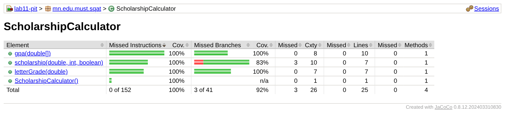
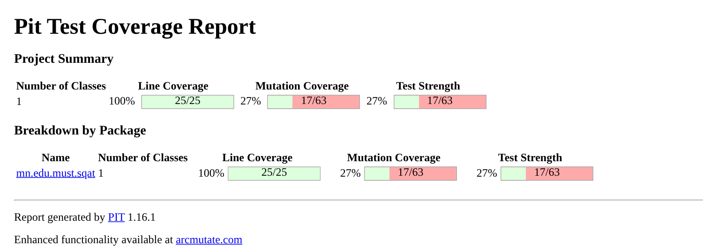
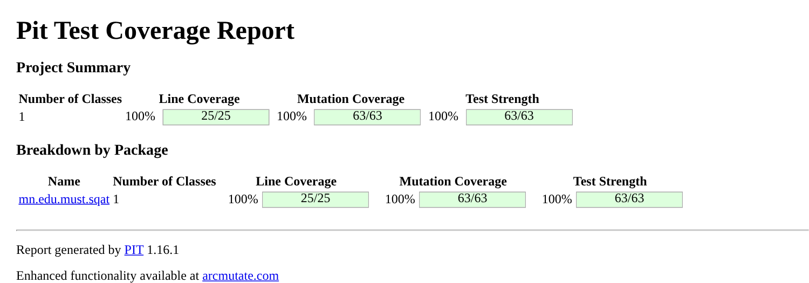

# Лаборатори №11: Mutation testing — PIT-ээр тестийн чанараа хэмжих

**F.CSA313 — Программ хангамжийн чанарын баталгаа ба тест (2026)**

| | |
|---|---|
| Овог нэр | Х.Дэлгэр (Khorolmaa Delger) |
| Оюутны код | B222270835 |
| Репозитори | https://github.com/Delger-Kh/lab11-pit |

### Орчин (`java -version`, `mvn -version`)

Бүтэн гаралт: [`results/env.txt`](results/env.txt)

```
java version "24.0.2" 2025-07-15
Java(TM) SE Runtime Environment (build 24.0.2+12-54)
Java HotSpot(TM) 64-Bit Server VM (build 24.0.2+12-54, mixed mode, sharing)

Apache Maven 3.9.16 (2bdd9fddda4b155ebf8000e807eb73fd829a51d5)
Maven home: C:\tools\apache-maven-3.9.16
Java version: 24.0.2, vendor: Oracle Corporation, runtime: C:\Program Files\Java\jdk-24
Default locale: en_US, platform encoding: UTF-8
OS name: "windows 10", version: "10.0", arch: "amd64", family: "windows"
```

> Тэмдэглэл: Windows 10 + PowerShell орчинд ажилласан. Гаралтуудыг `mvn ... > results\*.txt 2>&1`
> (cmd) хэлбэрээр текст файлд хадгалсан — `tee`-тэй ижил үр дүнтэй, UTF-8 текст.
> `src/main` кодыг лабын турш өөрчлөөгүй (Starter commit `ff61c01`-тэй харьцуулж болно).

---

## 1. Эхний хэмжилт (starter тестүүд)

### JaCoCo — Line 100% (25/25), Branch 38/41



Нотолгоо: [`results/mvn-verify-start.txt`](results/mvn-verify-start.txt),
[`results/jacoco-start.csv`](results/jacoco-start.csv) (`BRANCH_MISSED=3, BRANCH_COVERED=38, LINE_MISSED=0, LINE_COVERED=25`).

Дутуу 3 салаа бүгд `scholarship()`-д байна: `gpa < 0` хэзээ ч үнэн болдоггүй;
`gpa >= 3.8` үнэн ба `credits >= 15` худал тохиолдол алга; `gpa >= 3.4` үнэн ба `credits >= 12` худал тохиолдол алга.

### PIT — Mutation Coverage 27% (17/63)



Нотолгоо: [`results/pit-start.txt`](results/pit-start.txt)

```
>> Line Coverage (for mutated classes only): 25/25 (100%)
>> Generated 63 mutations Killed 17 (27%)
>> Mutations with no coverage 0. Test strength 27%
```

### Ажиглалт: Line Coverage ба Mutation Coverage-ийн зөрүү

JaCoCo мөр бүрийг 100% ажилласан гэж харуулж байхад PIT 63 мутантын зөвхөн 17-г (27%) алсан,
өөрөөр хэлбэл кодонд оруулсан 46 алдааг манай тестүүд огт анзаараагүй. Энэ нь хамралт зөвхөн
"код ажилласан эсэх"-ийг хэмждэг, харин тест гаралтыг зөв эсэхийг шалгаж байгаа эсэхийг хэмждэггүйг харуулж байна:
`assertNotNull`, `assertTrue(0 <= x <= 100)` гэх мэт сул assertion нь буруу үр дүнг ч "зөв" гэж хүлээн авна.
"No coverage" мутант 0 байгаа нь асуудал хамралтад биш, assertion-ы хүч болон зааг утгын тестэд байгааг баталж байна.

---

## A. Амьд мутантуудын ангилал (starter: 46 / 63 амьд)

Эх сурвалж: PIT тайлан `target/pit-reports/mn.edu.must.sqat/ScholarshipCalculator.java.html` (starter ажиллуулалт).
Мөрийн дугаар `ScholarshipCalculator.java`-гийн мөр.

| Мөр | Код | Мутаци (PIT-ийн тайлбар) | Тоо | Ангилал | Үндэслэл (1 өгүүлбэр) | Арга хэмжээ |
|---|---|---|---|---|---|---|
| 20 | `score < 0 \|\| score > 100` | changed conditional boundary (`<`→`<=`, `>`→`>=`) | 2 | Тест дутуу | `letterGrade(0)` = "F", `letterGrade(100)` = "A" байх ёстой ч мутант exception шиднэ — бодит зан төлөв өөрчлөгддөг, гэхдээ 0 ба 100-г тестлээгүй. | B2: зааг 0 → "F", 100 → "A" |
| 23–26 | `score >= 90 / 80 / 70 / 60` | changed conditional boundary (`>=`→`>`) | 4 | Тест дутуу | Мутант дээр яг 90 оноо "B", 80 "C" болж хувирдаг ч яг заагийн утгаар тестлээгүй. | B2: 90/89.99, 80/79.99, 70/69.99, 60/59.99 |
| 23–26 | `if (score >= …)` | removed conditional – replaced comparison check with **true** | 4 | Тест дутуу (сул assertion) | Жишээ нь 24-р мөрийг true болговол 75 оноо "B" буцаадаг ч `assertNotNull` ялгахгүй. | B1: `assertEquals("C", letterGrade(75))` г.м. |
| 23–26 | `if (score >= …)` | removed conditional – replaced comparison check with **false** | 4 | Тест дутуу (сул assertion) | Жишээ нь 23-р мөрийг false болговол 95 → "B" болдог ч `assertNotNull` ялгахгүй. | B1: яг үсгийг шалгах |
| 23–27 | `return "A" … "F"` | replaced return value with "" | 5 | Тест дутуу (сул assertion) | Хоосон мөр `""` null биш тул `assertNotNull` давна, гэхдээ дүн буруу. | B1: `assertEquals` яг үсэг |
| 36 | `switch (letterGrade(s))` | Changed switch default to be first case | 1 | Тест дутуу (сул assertion) | F дүнд 0 биш 4 оноо нэмэгдэж `gpa({40})` = 4.0 болдог ч `assertTrue(0..4)` давна. | B1: `gpa({40}) == 0.0` |
| 38, 40 | `total += 3`, `total += 1` | Replaced double addition with subtraction | 2 | Тест дутуу (сул assertion) | `gpa({95,85})` 3.5 биш 0.5, `gpa({75,65})` 1.5 биш 0.5 болдог ч 0–4 мужид багтаж давна. | B1: яг 3.5, 1.5 |
| 44 | `return total / scores.length` | replaced double return with 0.0d | 1 | Тест дутуу (сул assertion) | 0.0 нь 0–4 мужид багтах тул мужийн шалгалт барьдаггүй. | B1: яг голч |
| 48 | `gpa < 0`, `credits < 0` | changed conditional boundary (`<`→`<=`) | 2 | Тест дутуу | Голч 0 ба кредит 0 нь спецификацаар хүчинтэй ч мутант exception шиднэ — 0-ээр тестлээгүй. | B2: (0.0, 0) → 0, (3.0, 0) → 50 |
| 48 | `gpa < 0` | removed conditional – replaced comparison check with true (сөрөг голчийн шалгалт идэвхгүй) | 1 | Тест дутуу | Сөрөг голч exception шидэхээ больдог ч сөрөг голчтой тест байхгүй. | B2: `scholarship(-0.01, …)` throws |
| 51 | `if (hasViolation)` | removed conditional – replaced equality check with true / false | 2 | Тест дутуу (сул assertion) | Зөрчилтэй оюутан 100% авах, эсвэл бүх оюутан 0% авах — хоёулаа 0–100 мужид тул давна. | B1: (4.0, 20, true) → 0 ба бусад яг утга |
| 52 | `gpa >= 3.8 && credits >= 15` / `return 100` | boundary ×2, removed conditional (true/false) ×4, replaced int return with 0 ×1 | 7 | Тест дутуу | 3.8/15 заагийн тест байхгүй, `credits < 15` ба `gpa >= 3.8` хослол байхгүй, мөн 100-г 0 болгосныг мужийн шалгалт барьдаггүй. | B1 + B2: 3.8/15, 3.79/15, 3.8/14 |
| 53 | `gpa >= 3.4 && credits >= 12` / `return 70` | boundary ×2, removed conditional (true/false) ×4, replaced int return with 0 ×1 | 7 | Тест дутуу | Дээрхтэй ижил: 3.4/12 зааг, `credits < 12` хослол, яг 70 гэсэн assertion байхгүй. | B1 + B2: 3.4/12, 3.39/12, 3.4/11 |
| 54 | `gpa >= 3.0` / `return 50` | boundary ×1, removed conditional (true/false) ×2, replaced int return with 0 ×1 | 4 | Тест дутуу | 3.0 зааг ба 2.99 тест байхгүй, 50-г 0 болгосныг мужийн шалгалт барьдаггүй. | B1 + B2: 3.0 → 50, 2.99 → 0 |
| | | | **46** | | | |

**Equivalent мутант: 0.** 46 амьд мутант бүрт зан төлөв нь спецификациас ялгаатай болох оролт олдсон
(дээрх "Арга хэмжээ" баганад заасан), тиймээс бүгд "тест дутуу" ангилалд орно.
`return 0` (55-р мөр) дээр PIT мутант үүсгээгүй (0-г 0-ээр солих утгагүй).

Дүгнэвэл, 46 амьд мутант хоёр бүлэгт хуваагдана:
- **13 `changed conditional boundary`** мутант (20, 23–26, 48, 52–54-р мөр) болон сөрөг голчийн 1 мутант (48) нь **зааг утгын тест дутуу**-г заана → **B2**-оор засна.
- Үлдсэн **32** (`replaced return value`, `removed conditional`, `switch default`, `addition→subtraction`) нь **assertion сул**-ыг заана → ихэнхийг **B1** засна; харин 52–53-р мөрийн нөхцөлийг "true" болгосон мутантуудыг алахад "голч хүрээгүй ч кредит хүрсэн" / "голч хүрсэн ч кредит хүрээгүй" гэсэн шинэ оролт хэрэгтэй тул тэдгээр нь B2 хүртэл амьд үлдэнэ (доорх B1-ийн үр дүн үүнийг баталсан).

---

## B. Тестүүдээ хүчтэй болгох — гурван хэмжилтийн явц

| Хэмжилт | Commit | Тест | Mutation Coverage | Test Strength | Нотолгоо |
|---|---|---|---|---|---|
| Эхлэл (starter) | `839e78a` | 6 | **17/63 = 27%** | 27% | [`results/pit-start.txt`](results/pit-start.txt) |
| B1 — яг утгын assertion | `96f0c88` | 6 | **45/63 = 71%** | 71% | [`results/pit-B1.txt`](results/pit-B1.txt) |
| B2 — зааг утгын тест (эцсийн) | `d568f96` | 40 | **63/63 = 100%** | 100% | [`results/pit-B2.txt`](results/pit-B2.txt) |

Бүх хэмжилтэд Line Coverage 25/25 (100%) хэвээр — хамралт өөрчлөгдөөгүй ч mutation score 27% → 71% → 100% болсон.

### B1 — Assertion-уудыг хүчтэй болгох (27% → 71%)

Оролтуудыг starter-тэй **ЯГ ИЖИЛ** үлдээж, зөвхөн шалгалтыг өөрчилсөн:

| Өмнө (сул) | Дараа (хүчтэй) |
|---|---|
| `assertNotNull(calc.letterGrade(95))` | `assertEquals("A", calc.letterGrade(95))` (B, C, D, F мөн адил) |
| `assertTrue(g1 >= 0 && g1 <= 4)` | `assertEquals(3.5, calc.gpa(new double[]{95, 85}), EPS)`; 1.5; 0.0 |
| `assertTrue(s1 >= 0 && s1 <= 100)` | `assertEquals(100, calc.scholarship(3.9, 16, false))`; 70; 50; 0; зөрчилтэй → 0 |

B1 дангаараа **28 мутант** нэмж алсан: бүх `replaced return value` (5 + 4), `removed conditional` (letterGrade, hasViolation),
`switch default`, `addition→subtraction`. Энэ нь сул assertion-ийн мутантууд гэсэн A хэсгийн ангиллыг баталж байна.

**B1-ийн дараа амьд үлдсэн 18** ([`results/pit-B1.txt`](results/pit-B1.txt)):
- `changed conditional boundary` — 13 (мөр 20 ×2, 23–26 ×4, 48 ×2, 52 ×2, 53 ×2, 54 ×1): `ConditionalsBoundaryMutator` **14-өөс 1** л алагдсан.
- `removed conditional – replaced comparison check with true` — 5 (мөр 48 ×1, 52 ×2, 53 ×2): тестийн оролтууд нь нөхцөлийн "нэг нь хүрсэн, нөгөө нь хүрээгүй" хослолыг дайраагүй.

→ Яг утгын assertion хангалттай биш: оролт нь заагаас хол байвал `>=`/`>` хоёр ялгагдахгүй.

### B2 — Зааг утгын тестүүд (71% → 100%)

`@ParameterizedTest` + `@CsvSource`-ээр нэмсэн тестүүд (нийт 40 тест ажилласан):

| Арга | Зааг утгууд | Алсан мутант |
|---|---|---|
| `letterGrade_boundaries` | 100→A, 90→A, 89.99→B, 80→B, 79.99→C, 70→C, 69.99→D, 60→D, 59.99→F, 0→F | мөр 20, 23–26-ийн boundary |
| `letterGrade_outOfRange_throws` | -1, -0.01, 100.01, 101 | хязгаарын шалгалт |
| `gpa_eachLetterHasExactPoints` | A=4, B=3, C=2, D=1, F=0 тус бүр | switch-ийн бүх салаа |
| `gpa_allFiveLetters_average` | {95,85,75,65,30} → 2.0 | давталтын нийлбэр |
| `gpa_invalidInputs_throw` | null, {}, {90, 101} | |
| `scholarship_boundaries` | 3.8/15→100, 3.79/15→70, 3.8/14→70, 4.0/15→100, 3.4/12→70, 3.39/12→50, 3.4/11→50, 3.0/0→50, 2.99/20→0, 0.0/0→0, 4.0/0→50 | мөр 48 (gpa=0, credits=0), 52–54-ийн boundary ба "true" мутантууд |
| `scholarship_violationAlwaysZero_evenForTopStudent` | (4.0, 20, true), (3.8, 15, true) → 0 | hasViolation |
| `scholarship_invalidInputs_throw` | gpa -0.01, 4.01, 4.1; credits -1 | мөр 48-ийн сөрөг голч |

**Эцсийн үр дүн:** `>> Generated 63 mutations Killed 63 (100%)`, `Test strength 100%` — зорилт (≥ 85%) биелсэн.
Equivalent мутант үлдээгүй тул Test Strength = Mutation Coverage = 100%.
Дагалдах үр дүн: JaCoCo Branch **38/41 → 41/41** ([`results/jacoco-B2.csv`](results/jacoco-B2.csv)).




---

## C. Гараар нэг мутант — PIT-гүйгээр

### Гар мутаци: `gpa >= 3.8` → `gpa > 3.8`

`ScholarshipCalculator.java`-гийн 52-р мөрийг гараар өөрчилж `mvn test` ажиллуулсан
(бүтэн гаралт: [`results/mvn-test-manual-mutant.txt`](results/mvn-test-manual-mutant.txt)):

```
52:        if (gpa > 3.8 && credits >= 15) return 100;

[ERROR] Tests run: 40, Failures: 1, Errors: 0, Skipped: 0
[ERROR] mn.edu.must.sqat.ScholarshipCalculatorTest.scholarship_boundaries(double, int, int)[1] <<< FAILURE!
org.opentest4j.AssertionFailedError: expected: <100> but was: <70>
[ERROR]   ScholarshipCalculatorTest.scholarship_boundaries:128 expected: <100> but was: <70>
[INFO] BUILD FAILURE
```

**Унасан тест:** `scholarship_boundaries[1]` — оролт `(3.8, 15, false)`. Спецификацаар голч 3.8 ба кредит 15 бол 100%
байх ёстой, харин мутант `3.8 > 3.8` худал болж дараагийн дүрэм рүү орж 70% буцаасан. Энэ бол B2-д нэмсэн
**яг заагийн** тест — starter-ийн (3.9, 16) оролт энэ мутантыг хэзээ ч барихгүй.
Үүний дараа `git restore src/main`-ээр кодыг буцааж, `git status src/main` хоосон байгааг шалгасан — мутацитай код commit хийгдээгүй.

### Өөрийн зохиосон EQUIVALENT мутант

```java
// эх:      if (scores == null || scores.length == 0) {
// мутант:  if (scores == null || scores.length <= 0) {
```

Java-д массивын урт (`length`) хэзээ ч сөрөг байж чаддаггүй тул `length <= 0` ба `length == 0` нь ямар ч оролтод яг
ижил үр дүн өгнө — өөрөөр хэлбэл энэ мутант програмын ажиглагдах зан төлөвийг огт өөрчлөхгүй.
Иймээс түүнийг "алах" тест бичих боломжгүй: ямар ч тест эх код болон мутант дээр адилхан гаралт авна, тиймээс
энэ нь тест дутуу биш, жинхэнэ **equivalent** мутант бөгөөд mutation score-ийг тооцохдоо хасах ёстой.

---

## Дүгнэлт

Энэ лабын гол сургамж: **хамралт ба тестийн чанар бол хоёр өөр зүйл**. Starter багц JaCoCo-оор Line 100% өгч байсан ч
PIT-ийн 63 мутантын зөвхөн 27%-ийг алсан — код бүрэн ажилласан ч тест нь гаралтыг бараг шалгаагүй.
Хамралт "энэ мөр ажилласан уу?" гэж асуудаг бол mutation score "энэ мөрөнд алдаа гарвал тест маань унах уу?" гэж асуудаг.
B1 (яг утгын assertion) score-ийг 71% хүргэсэн ч boundary мутантууд үлдсэн, учир нь заагаас хол оролтоор `>=` ба `>`-ийг ялгаж чадахгүй;
B2-ийн зааг утгын тестүүд л 100% хүргэсэн. Тиймээс сайн тест = зөв оролт (зааг утга) + хүчтэй oracle (яг утга) хоёулаа.
AI-аар тест бичүүлэхэд хамралт өндөр харагддаг ч `assertNotNull`, мужийн шалгалт зэрэг сул assertion эсвэл заагийн тест дутуу
байх нь элбэг — хамралт үүнийг илрүүлдэггүй. Mutation score нь AI-ийн бичсэн тестийг объектив шалгах арга бөгөөд
амьд үлдсэн мутант бүр "энэ алдааг таны тест барихгүй" гэсэн тодорхой, засаж болохуйц даалгавар болдог.
Иймээс AI-аар үүсгэсэн тестийг PIT-ээр шалгаж, амьд мутантуудыг алтал сайжруулах нь хамгийн найдвартай баталгаа юм.

---

### Commit түүх

```
ff61c01  Starter
839e78a  Initial measurement: JaCoCo line 100%, PIT start   (27%)
feb49f8  A: classify 46 surviving mutants (README table)
96f0c88  B1: replace weak assertions with exact assertEquals (71%)
d568f96  B2: add boundary-value tests (final PIT run)        (100%)
430ebad  C: manual mutant (gpa >= 3.8 -> gpa > 3.8) test output, src/main restored
```

### Дахин ажиллуулах

```bash
mvn clean verify                                              # JaCoCo: target/site/jacoco/index.html
mvn test-compile org.pitest:pitest-maven:mutationCoverage     # PIT:    target/pit-reports/index.html
```
